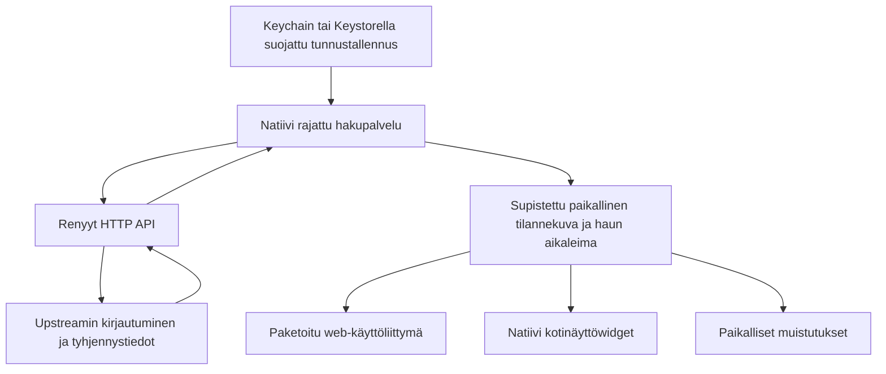

# Mobiilisovelluksen ja kotinäyttöwidgettien toteutusselvitys

Arvioitu 21.10.2026. Tämä on toteutussuositus ja rajattu jatkosuunnitelma;
repo ei vielä sisällä natiivisovellusta tai widgettiä. Alustafaktat perustuvat
alla linkitettyihin valmistajien ohjeisiin, ylläpitoarviot nykyiseen Renyyt-koodiin.

## Suositus

Säilytetään PWA kevyenä, itsenäisesti toimivana käyttöliittymänä. Seuraava
kokeilu kannattaa tehdä **Capacitorilla paketoidusta nykyisestä web-käyttöliittymästä
ja Androidin natiivista Kotlin/Glance-widgetistä**. iOS tarvitsee myöhemmin oman
SwiftUI/WidgetKit-laajennuksen. Flutteriin tai React Nativeen siirtyminen ei
nykyisillä tarpeilla perustele koko käyttöliittymän uudelleenkirjoittamista.

Suositus on kokeilun lähtökohta, ei päätös ottaa kehys tuotantoriippuvuudeksi.
Kokeilun pitää ensin osoittaa, että tunnukset voidaan pitää natiivipuolella,
sama supistettu data toimii sovelluksessa ja widgetissä ja taustapäivityksen
rajoitukset näkyvät käyttäjälle ymmärrettävästi. Jos natiivisilta osoittautuu
käyttöliittymän uudelleenkäyttöä raskaammaksi, Androidin Kotlin-kumppanisovellus
on varavaihtoehto; se kuitenkin jättäisi PWA:n kirjautumisen ja asetukset erilleen.

## Lähtötilanne tässä repossa

- `web/app.js` sisältää jo yhdeksän kieltä, RTL:n, astiarajaukset, oman järjestyksen,
  kalenteriviennin, offline-korttidatan ja PWA-asennuksen. Näitä ei kannata menettää.
- `web/helpers.js` tarjoaa puhdasta päivämäärä-, järjestys- ja kalenterilogiikkaa;
  nykyinen DOM-käyttöliittymä ei sellaisenaan toimi natiivin widgetin piirtona.
- `POST /api/v1/renyyt` välittää tunnukset upstreamiin vain pyynnön ajaksi.
  Python-palvelin ei säilytä niitä eikä voi itsenäisesti hakea uusia tyhjennyksiä.
- Web Push tallentaa tilauksen ja selaimesta synkronoidut tyhjennyspäivät.
  Ajastettu ilmoitus ei siis todista, että upstreamin päivät ovat yhä samat.
- Nykyinen selainblob on sumennus: avain kulkee mukana. Sen kopioiminen
  natiivisovelluksen asetuksiin ei tee tunnusten säilytyksestä turvallista.

## Vaihtoehtojen vertailu

Taulukon työmäärät ovat suhteellisia arvioita tälle repolle, eivät tuntiarvioita.
Android/iOS-kotinäyttöwidget tarkoittaa käyttöjärjestelmän omaa widgettiä,
ei verkkosivun sisään upotettua näkymää.

| Vaihtoehto | Nykyisen UI:n hyödyntäminen | Widgetit ja taustatyö | Arvio |
| --- | --- | --- | --- |
| Nykyinen PWA | Kaikki säilyy | Ei suoraa AppWidget/WidgetKit-toteutusta; selaimen taustarajoitukset | Paras peruspalvelu jatkossakin, ei yksin widget-ratkaisu |
| Ohut etäsivun WebView-kääre | Paljon | Tarvitsee silti natiivikerrokset; etäsisältö ja natiivisilta vaativat erityistä huolellisuutta | Vähän lisäarvoa suhteessa omaan ylläpidettävään pakettiin |
| Capacitor ja sovellukseen paketoitu web-UI | Suuri osa HTML/CSS/JS:stä ja käännöksistä | Kotlin/Glance ja SwiftUI/WidgetKit sekä natiivi tallennus/haku | Suositeltu kokeilu: pienin arvioitu UI:n uudelleenkirjoitus |
| Flutter / React Native | Lähinnä rajapintasopimus, käännökset ja osa puhtaasta logiikasta | Alustaintegraatiot ja natiivit widgetit tarvitaan edelleen | Lisää uuden UI- ja työkaluketjun ilman osoitettua tarvetta |
| Kotlin + Swift, täysin natiivit sovellukset | UI kirjoitetaan uudestaan kahdesti | Suora yhteys alustojen API:hin | Hyvä alustahallinta, suurin UI:n rinnakkaisylläpito |

[Capacitorin konfiguraatio](https://capacitorjs.com/docs/config) tukee paketoituja
web-resursseja. Sen `server.url` on tarkoitettu kehityksen live reloadiin, ei
suositelluksi tuotantoratkaisuksi. Myös
[Flutterin alustakanavat](https://docs.flutter.dev/platform-integration/platform-channels)
ja [React Nativen natiivimoduulit](https://reactnative.dev/docs/turbo-native-modules-introduction)
osoittavat, ettei yhteinen UI-kehys poista alustakohtaisten toimintojen toteutusta.

## Tietovirta ja tunnukset

Ensimmäinen kokeilu käyttää olemassa olevaa Renyyt-välityspalvelinta. Suoraa
upstream-kirjautumista ei kopioida eri mobiilitoteutuksiin eikä puhelimeen
paketoida Python-palvelinta. Näin session-init → login → services -ketju
säilyy yhdessä paikassa. HTTPS-palvelin ja mahdollinen alihakemistopolku
valitaan asetuksissa; oletuksena käytetään palvelun nykyistä osoitetta.

iOS:ssa tunnukset kuuluvat Keychainiin. Androidissa Keystore säilyttää
salausavaimen, jolla sovelluksen yksityinen tunnusblob suojataan; Keystore ei
itsessään ole merkkijonosalasanojen tietokanta.
[Androidin Keystore-ohje](https://developer.android.com/privacy-and-security/keystore)
kuvaa avainten suojausta ja käyttörajoituksia.
[Capacitor Preferences](https://capacitorjs.com/docs/apis/preferences) käyttää
UserDefaultsia/SharedPreferencesia, joten se sopii tavallisiin asetuksiin,
ei sellaisenaan tähän salaisuuksien säilytysratkaisuksi.

Natiivisilta tarjoaa esimerkiksi `fetchCollections`- ja `forgetAccount`-toiminnot,
ei JavaScriptistä kutsuttavaa yleistä `getPassword`-toimintoa. Native-haku lähettää
tunnukset HTTPS-POSTissa palvelimelle ja palauttaa UI:lle supistetun datan.
Palvelin ei ala säilyttää tunnuksia tätä varten. Palvelimen vaihto vaatii uuden
kirjautumisen: silta ei saa lähettää vanhaa salasanaa mielivaltaiseen uuteen URL:iin.
Palautetut raakavastaukset, tunnukset ja kirjautumispyynnöt eivät kuulu lokiin.

Widgetille jaetaan vain paikallinen astiatunniste, nimi/jätelaji, tiedossa oleva
päivä, näkyvyys/järjestys, kieli ja viimeisimmän onnistuneen haun aika. Ei salasanaa,
asiakasnumeroa, osoitteita tai kimppaosakkaiden raakatietoja. iOS:ssa sovellus ja
laajennus voivat jakaa tämän tilannekuvan App Group -säilössä; tunnukset jäävät
ensisijaisesti pääsovellukselle. [Applen App Group- ja Keychain-kuvaus](https://developer.apple.com/documentation/security/sharing-access-to-keychain-items-among-a-collection-of-apps)
erottelee jaetun sovellusdatan ja Keychain-käyttöoikeudet.

Lukitun laitteen taustahaku ja vahva käyttäjätunnistusta vaativa avain voivat olla
ristiriidassa. Kokeilun oletus on rajoittaa salaisuuden käyttöä, näyttää välimuisti
ja sallia haun lykkääntyminen. Taustakäytön laajentaminen pitää arvioida erikseen.
Uloskirjautuminen poistaa salaisuudet, jaetun välimuistin ja tämän sovelluksen
ajastetut muistutukset. Varmuuskopiointi ja uudelleenasennus testataan erikseen;
niitä ei oleteta samaksi asiaksi kuin uloskirjautuminen.

## Rajapinta ja nykyiset suojausrajat

Nykyinen web-UI muodostaa API-osoitteet saman originin polkuina. Paketoidussa
sovelluksessa API-palvelin pitää siksi erottaa UI:n resurssien osoitteesta.
Capacitorin oletusorigin on iOS:ssa `capacitor://localhost` ja Androidissa
`https://localhost`; palvelimen saman originin sääntö ei automaattisesti kata niitä.

Lisäksi nykyinen Python-palvelin ei palauta selaimen cross-origin-hakujen tarvitsemia
`Access-Control-Allow-*`-otsakkeita. Pelkkä `RENYYT_ALLOWED_ORIGINS`-listan muutos
**ei siis riitä** WebView'n fetch-kutsujen ratkaisuksi. Suositeltu kokeilu tekee
haut natiivissa HTTP-kerroksessa, jonka pyynnöillä ei ole selaimen Origin-otsaketta.
Nykyinen `_validate_api_origin` sallii tällaisen asiakkaan, mutta Host-tarkistus,
kokorajat ja rate limiting säilyvät. Native-pyynnön framing ja Content-Length
varmistetaan olemassa olevaa palvelinta vasten.

Host/Origin/CSP-suojauksia tai CORS:ia ei avata yleisesti mobiilin vuoksi.
WebView lataa vain sovelluksen mukana tulevaa luotettua sisältöä; ulkoiset linkit
avataan järjestelmän selaimessa, eikä vieraille sivuille anneta natiivisiltaa.
Sovellus ei kuljeta palautettavaa salasanaa upotus-URL:ssa.

## Widgettien päivitys ja tiedon vanheneminen

Kaksi eri asiaa erotetaan: päivälaskurin vaihtuminen ja uusien päivien hakeminen.
Tiedossa olevasta tyhjennyspäivästä voidaan tehdä widgetin aikajana ilman uutta
verkkohakua joka yö. Tämä ei vahvista upstream-tiedon tuoreutta.

Androidissa Glance/AppWidget näyttää pysyvän tilannekuvan. WorkManager hoitaa
verkkohakuyrityksiä esimerkiksi muutaman kerran vuorokaudessa sekä sovelluksen
avauksen yhteydessä. [Widget-päivitysten ohjeessa](https://developer.android.com/develop/ui/views/appwidgets/advanced)
`updatePeriodMillis`-päivityksen alaraja on 30 minuuttia.
[WorkManagerin jaksotyön](https://developer.android.com/develop/background-work/background-tasks/persistent/getting-started/define-work)
alaraja on 15 minuuttia, mutta suoritus ei ole täsmällinen eikä näillä taajuuksilla
ole tarvetta hakea jäteastioiden tietoja jatkuvasti.

WidgetKit käyttää aikajanoja ja järjestelmän säätelemiä päivityksiä, ei jatkuvasti
käyvää sovellusta. [Applen widget-suunnitteluohje](https://developer.apple.com/videos/play/wwdc2021/10048/)
kuvaa päivitysbudjettia ja ennakkoon annettavia aikajana-arvoja. Tämä sopii
päivämääräpohjaiseen Renyytiin, mutta ei takaa tuoretta upstream-hakua joka aamu.
Myöskään [Capacitor Background Runner](https://capacitorjs.com/docs/apis/background-runner)
ei kierrä käyttöjärjestelmien taustarajoituksia.

Widget näyttää aina päivämäärän ja viimeisen onnistuneen haun ajan. Puuttuva,
vanhentunut tai epäonnistunut haku merkitään näkyvästi. Jo menneen tyhjennyspäivän
jälkeen ei päätellä seuraavaa päivää tyhjennysvälistä: poikkeukset ja pyhäpäivät
voivat muuttaa sitä. Tällöin tarjotaan päivitystä tai sovelluksen avaamista.
Päivänvaihto, kesäaika, aikavyöhykkeen vaihto ja laitteen kellon muutos testataan.

Widgetin napautus avaa sovelluksen, jonka voi päivittää käsin. Taustapäivityksen,
pushin tai laskurin täsmällistä ajoitusta ei luvata, etenkään pakotetun sulkemisen,
virransäästön, uudelleenkäynnistyksen tai lukituksen jälkeen.

## Muistutukset ja jakelu

Ensimmäinen natiivikokeilu ajastaa käyttäjän luvalla paikalliset muistutukset
onnistuneesti haetuista päivistä ja korvaa ne tiedon muuttuessa. Tämä toimii
ilman omaa APNs/FCM-taustapalvelua; käyttöjärjestelmän toimitus- ja lupakäytännöt
silti koskevat ilmoituksia. [Applen paikallisten ilmoitusten ohje](https://developer.apple.com/documentation/usernotifications/scheduling-a-notification-locally-from-your-app)
ja [Capacitor Local Notifications](https://capacitorjs.com/docs/apis/local-notifications)
kuvaavat mekanismin. Androidin tarkkojen hälytysten erityislupaa ei oteta oletuksena.

Nykyinen Web Push säilyy PWA:lle. Natiivin APNs/FCM-rekisteröinnin lisääminen olisi
oma myöhempi muutos, ei nykyisen Web Push -tilauksen automaattinen uudelleenkäyttö.
[WebKitin PWA-push-kuvaus](https://webkit.org/blog/13878/web-push-for-web-apps-on-ios-and-ipados/)
selittää iOS:n aloitusnäyttöasennuksen ja käyttäjän eleestä pyydettävän luvan.

Androidin ensimmäinen kokeilu voidaan jakaa testaajille allekirjoitettuna APK:na.
Play-jakelu ja sen allekirjoitus-/SDK-/tietosuojavaatimukset tarkistetaan ennen
julkaisua. iOS vaatii sopivan Xcoden, allekirjoituksen/profiilit ja laitetestauksen;
TestFlight/App Store edellyttää ylläpitäjän kehittäjätilin valmistelua.
[App Review -ohjeen kohta 4.2](https://developer.apple.com/app-store/review/guidelines/#minimum-functionality)
edellyttää verkkosivun uudelleenpaketointia laajempaa hyötyä. Widgetit ja natiivit
muistutukset tuovat sellaista arvoa, mutta hyväksyntää ei voi luvata etukäteen.
Salaisia allekirjoitusavaimia ei luoda tai julkaista tämän selvityksen yhteydessä.

## Ehdotettu seuraava kokeilu ja hyväksymiskriteerit

1. Android ensin, yksi tili ja käyttäjän valitsema HTTPS-Renyyt-palvelin. Paketoitu
   nykyinen UI, natiivi suojattu tallennus sekä yhteinen natiivi haku/normalisointi.
   Todennetaan root- ja `/renyyt/`-polut ilman palvelimen suojausten heikentämistä.
2. Yksi pieni tai keskikokoinen Glance-widget: valitut astiat, päivä/laskuri,
   manuaalinen järjestys, hakuaika, offline-/virhetila ja avaus sovellukseen.
   Sama minimimuotoinen snapshot palvelee UI:ta ja widgettiä.
3. Paikalliset muistutukset, lupa evättynä toimiva sovellus ja siivous
   uloskirjautumisessa. Ajastus päivittyy, kun palvelin palauttaa muuttuneen päivän.
4. GitHubissa Androidin build, normalisointi-/päivämäärätestit ja emulaattorin
   perussavutesti. iOS-laajennukselle myöhemmin macOS/Xcode-simulaattoribuild.
   Nykyiset PWA/Python/kolmen selaimen portit säilyvät rinnalla.
5. Oikeilla laitteilla vähintään usean vuorokauden testi: yö/päivänvaihto,
   virransäästö, pakotettu sulkeminen, offline, uudelleenkäynnistys, aikavyöhyke,
   muuttunut salasana, API-virhe ja poistaminen/uudelleenasennus. Emulaattori- tai
   CI-build ei todista taustapäivitysten luotettavuutta.

Kokeilu hyväksytään jatkoon vasta, kun widget ei tarvitse salasanaa, JS ei saa
palautettavaa tallennettua salasanaa, vanha tieto erottuu tuoreesta, RTL ja kaikki
nykyiset kielet toimivat ja nykyinen PWA toimii edelleen itsenäisesti.
Ennen laajempaa toteutusta ylläpitäjän päätettäviksi jäävät ensimmäiset
laite-/OS-kohteet, jakelukanavat ja allekirjoitustilit sekä hyväksyttävä
lukitun laitteen taustahaun tietosuojakäytäntö. Tässä vaiheessa suositellaan
rajattua prototyyppiä, ei kahden valmiin kauppasovelluksen rakentamista.
